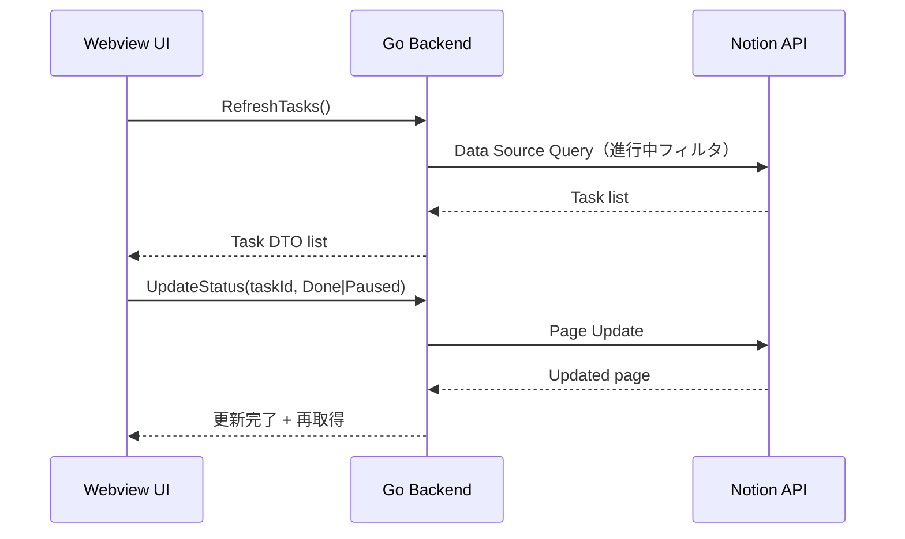

# 基本設計

## 画面・UX設計

- メニューバーアイコン（テンプレートアイコン推奨）
- 左クリックで小窓の表示/非表示をトグル
- 右クリックでメニュー表示（リフレッシュ/設定/終了）
- 小窓は「進行中タスクのみ」を表示し、Status は表示しない

### 操作導線

1. メニューバーアイコンクリック → 小窓表示
2. タスク横の「完了」「中断」を実行
3. 成功/失敗をトースト表示

## システム構成

- Go (Wails v3) バックエンド
- Wails Webview フロントエンド
- Notion API（REST）

Wails v3 の System Tray 機能とウィンドウ attach 機能を使い、メニューバー常駐と小窓トグルを実現する。

## データフロー



## 非機能要件

- パフォーマンス: 必要なプロパティのみ取得（title/url/last_edited_time 等）
- レート制限: 429 時は Retry-After を尊重しバックオフ
- オフライン: 最終取得結果を表示し「オフライン」表記
- セキュリティ: トークンは Keychain 優先、ログはマスク

## ローカル保存方針

- Keychain: Notion トークン
- 設定ファイル: `~/Library/Application Support/<AppName>/config.json`
  - database_id
  - data_source_id（初回取得後に保存）
  - status_property_name
  - status_in_progress / status_done / status_paused（更新/フィルタ用、UI非表示）
- キャッシュ: `~/Library/Caches/<AppName>/tasks.json`（任意）
- ログ: `~/Library/Logs/<AppName>/app.log`

## 更新戦略

- ポーリング間隔: 60 秒
- 手動リフレッシュあり
- 変更検知: last_edited_time で差分更新
- 更新直後は即時再取得

## ログ設計

- Level: ERROR/WARN/INFO/DEBUG
- トークンや個人情報はマスク

## エラー設計

- 401/403: 権限不足 → 設定画面誘導
- 404: DB/データソース未共有
- 429: バックオフ + Retry-After
- 5xx/timeout: リトライ + UI に警告

## 前提 / 仮定 / 未決事項

### 前提

- 対象 Database は 1 つ

### 仮定

- Status は UI には表示しないが、更新のために値は設定する

### 決定事項

- 中断タスクの「戻す」導線はメニューから「中断一覧」へ一時切替

## 参照すべき公式ドキュメント項目

- Wails v3: System Tray / Tray Menu / Window attach / Window options
- Notion API: Data Source model / Query a Data Source / Update Page / Versioning / Request limits

---

## v2: 今日の絞り込みと習慣の週集計

- 作成日: 2026-11-12 / 状態: 基本設計（draft）
- 上流: `docs/overview.md` の「v2」（FT-01〜08 / FR-01〜08 / NFR-01〜06）
- 影響範囲の分析: `.claude/docs/impact-analysis/2026-11-11_task-focus-and-habit-streak.md`

### 構成

レイヤー（UI → RPC → `app.App` → `notion.Client` → Notion）は v1 のまま変えない。新しい依存ライブラリは入れない。

```
                 main.go
[Tray label] <-- ラベル送り goroutine <-- 通知（最新値のみ） --+
                                                              |
[Popover JS] --RPC--> handleRawMessage --> app.App -----------+--> notion.Client --> Notion API
  タスク/習慣タブ                           | キャッシュ（生データ）      | queryAll（ページ送り）
  週集計の欄                                | 派生の計算（純関数）         | フィルタ組み立て
[Settings JS] --RPC--> handleRawMessage --+ | 取得結果（DB ごと）          | APIError（種類つき）
                                            | 過去分の取得系統（別 goroutine）
                                            | 日付の切り替わり検知
```

| コンポーネント  | v2 で増える責務                                                                                                                                                                                                                             | 主な場所                                                                    |
| --------------- | ------------------------------------------------------------------------------------------------------------------------------------------------------------------------------------------------------------------------------------------- | --------------------------------------------------------------------------- |
| `notion.Client` | ページ送りで全件取得する。複合フィルタ（期日・ステータス・作成日時）を組む。期日・優先度・ゴール・作成日時・7 列のチェックを読む。失敗を種類つきの `APIError` で返す                                                                        | `internal/notion/client.go` `types.go`                                      |
| `app.App`       | 生データのキャッシュ（タスク、今週の習慣ページ、過去の習慣ページ）。読み出しのたびに、まとまり・並び順・週集計・件数を今の日付で計算する。DB ごとの最終取得結果を持つ。日付の切り替わりで過去分を取り直す。件数が変わったら購読者へ知らせる | `internal/app/` に `task_view.go` `habit_summary.go` `sync_state.go` を新設 |
| `main.go`       | トレイの件数ラベルを購読して更新する。ポーリングの開始を `setupTray` の後に移す。新しい RPC を足す                                                                                                                                          | `cmd/nudge/main.go`                                                         |
| UI（JS）        | まとまりごとの描画、期日・優先度の表示、「開始」ボタン、「直近 7 日」の折りたたみ、週集計の欄、取得失敗の表示、設定カードの新項目                                                                                                           | `cmd/nudge/assets/*`                                                        |

### 技術スタック

| 項目                 | 選定                                    | 選定理由                                                                                                                                                                                                                                                                              |
| -------------------- | --------------------------------------- | ------------------------------------------------------------------------------------------------------------------------------------------------------------------------------------------------------------------------------------------------------------------------------------- |
| 言語・フレームワーク | Go 1.24 / Wails v3 alpha.53（変更なし） | 既存のまま。v2 はアプリ内の機能追加で、基盤を変える理由がない                                                                                                                                                                                                                         |
| メニューバーの文字   | Wails の `SystemTray.SetLabel`          | 標準 API で、cgo やネイティブ連携を足さずに済む（ADR-0006 の方針を守る）。alpha.53 の実装は `InvokeSync` でメインスレッドに渡して終わるまで待つ（`pkg/application/systemtray.go:84-92`）。メインスレッド以外の goroutine から呼べば安全で、メインスレッドから呼ぶと待ち合いになりうる |
| 日付・週の計算       | Go 標準の `time`（`time.Local`）        | ローカルタイムゾーンで判定する要件（NFR-03）に合う。テストでは時刻と TZ を注入する                                                                                                                                                                                                    |
| 折りたたみ状態の保存 | Webview の `localStorage`               | 見た目だけの状態で、設定ファイルに入れるほどではない                                                                                                                                                                                                                                  |

### 設計方針

1. **取得と計算を分ける（FR-01・02・05・06・07）**: キャッシュには Notion から取った生データだけを置く。まとまり・並び順・件数・週集計は、RPC の応答とラベル更新のたびに、その時点の今日を基準にした純関数で計算する。0 時をまたいでも、次の表示から振り分けが変わる。
2. **タスクの取得条件（FR-01・03、NFR-01）**: 期日プロパティと完了・中断の値が設定されている DB では、次の条件で 1 回の問い合わせをし、ページ送りで全件取る。`or[ ステータス = 進行中, and[ 期日 ≦ 今日＋8 日, ステータス ≠ 完了, ステータス ≠ 中断 ] ]`。
   - ステータス条件のキーは、既存の `buildStatusFilter` / `buildStatusUpdate`（`client.go:253-275`）と同じく `status_property_type` で `status` か `select` に切り替える。`≠` は同じ切り替えで `does_not_equal` を使う。Status 型は常に値を持つので空のページは起きない。Select 型で空のページが `does_not_equal` に当たるかは実装時に確かめ、当たらない場合は `or[ is_empty, does_not_equal ]` で補う（2 段の上限に収まるよう、そのときは `and` の中を Go 側の判定に寄せる）。
   - フィルタの日付はタイムゾーンを省くと UTC 扱いになるので、1 日の余裕を取り、最終の判定は Go 側でローカル日付に直して行う。期日は期間なら終了日を使う。
   - 条件がそろわない DB は v1 の条件（進行中のみ）で取る。
   - ページ送りは `has_more` が false になるまで `next_cursor` を渡して続ける（ちょうど 100 件のときも `has_more` で終わる）。
3. **習慣の取得（FR-06、NFR-01・05）**: 「今週分」と「過去分」を別の系統で取る。
   - 今週分: 作成日時 ≧ 今週の日曜 0:00（ローカル時刻をオフセット付きで渡す）。毎回のポーリングで、タスクと同じ `refreshAll` の中で取る。今日の一覧と件数は今週分だけから作る（先週のページを代用しない）。
   - 過去分: 52 週前の日曜 0:00 ≦ 作成日時 < 今週の日曜 0:00。`refreshAll` とは別の goroutine と別のロック（`historyMu`）で取り、`refreshMu` を持たない。同時に 1 本だけ走らせ、走っている間の要求は 1 回にまとめる。取り終えたらキャッシュを丸ごと差し替える。取っている間も RPC は前のキャッシュで応える。
   - 過去分を取るきっかけ: 起動時、日付の切り替わり、手動更新（タブの更新ボタンとトレイの「リフレッシュ」。習慣のチェックなど操作の後の再取得では取らない）、設定の保存。キャッシュには「何日の時点で取ったか」を持ち、今日と違えば取り直す。
   - 過去分の失敗: 前のキャッシュを残し、連続達成週数は前のキャッシュで出す。一度も取れていないときは連続達成週数を null（画面では「—」）にする。メニューバーの「!」には含めない。取得結果（API-006）には過去分の失敗として別に載せる。再試行は 5 分 → 15 分 → 60 分と間隔を空け、以後は 60 分ごとにする（毎分は再試行しない）。
4. **メニューバーの件数（FR-05、NFR-04）**:
   - `app.App` は件数が変わりうるとき（ポーリング、手動更新、操作後の再取得、過去分の差し替え、設定の保存）に、ロックを外してから「変わった」という合図だけを、容量 1 の channel に送る（溜まっていれば捨てる）。値は送らない。
   - `main.go` の 1 本の goroutine がその合図を受けるたび、その時点のキャッシュから件数を計算し直して `SetLabel` を呼ぶ。値ではなく合図を送るので、古い件数が後から届いて逆転することはない。`SetLabel` をメインスレッド（RPC やメニューの処理の中）から直接呼ばない。
   - 購読の登録は起動時に 1 回だけ（`SetSummaryNotifier`）。`saveConfig` でポーリングをやり直しても登録は増えない。ポーリングの開始は、登録と `setupTray` の後にする。
   - 表示: DB ごとの最終取得結果（今週分とタスク）のうち 1 つでも失敗があれば「!」。起動して最初の取得が終わるまでと、トークンや有効な DB が無いときはラベルを空にする。
5. **失敗の分類（NFR-06）**: `notion.Client` は HTTP の応答から作る `APIError`（状態コード・Notion のエラーコード）と、通信の失敗（タイムアウト・接続）をそのまま返す。設定の不備（プロパティ名が空など）は `APIError` ではなく、`app` 側の入力チェックの誤り（`ErrInvalidConfig`）として返す。`app` 側でこれらを、権限（401/403）、未共有（404）、レート制限（429）、通信、サーバ（5xx）、設定、の種類に分ける。失敗は DB 名と種類をログに出し、`Poller` に logger を渡して握りつぶさない。トークンはログに出さない。
6. **優先度の順（FR-02・08）**: 設定に「高い順に並べた優先度の値の配列」を保存する。配列に無い値と空は最後に回す。Notion の選択肢の並び順には頼らない。
7. **互換（NFR-02）**: 新しい設定項目は空で既存と同じ動作になる。設定の正規化で既定値を補わない方針（v1）を守る。曜日の列が 7 つそろわない習慣 DB は、週集計をしない。
8. **日付の切り替わり**: ポーリングのたびに前回のローカル日付と比べ、変わっていたら過去分の取り直しを要求し、件数の合図を送る。
9. **設定の保存（FR-08）**: `saveConfig` のあとは、全 DB のキャッシュ（タスク、今週分、過去分）と取得結果を捨てて取り直す。プロパティ名や曜日の列が変わっても、古いデータで計算しない。最初の取得が済んだ印はそのまま残し、取り直しが終わるまでラベルは前の値のままにする。取得の途中で設定が保存されたときに古い結果を書き戻さないよう、設定の世代番号で照合する（詳細設計 5.4・5.5）。
10. **複数 DB**: 小窓のタブは v1 と同じく DB ごとに分かれる（ADR-0007）。まとまりと並び順は DB ごとに API-001 の中で作り、DB をまたいで混ぜない。件数だけは全 DB を合算する（FR-05）。

### 画面一覧

| ID     | 画面                               | v2 の変更                                                                                                                                                                  | 対応機能     | 使う RPC                  |
| ------ | ---------------------------------- | -------------------------------------------------------------------------------------------------------------------------------------------------------------------------- | ------------ | ------------------------- |
| SC-001 | 小窓のタスクタブ                   | まとまり（期限切れ・今日・「進行中」・直近 7 日）の見出しと件数。期日・優先度の表示。期限切れの強調。未着手に「開始」。「直近 7 日」は既定で折りたたみ、開閉の状態は覚える | FT-01〜04    | API-001, API-004          |
| SC-002 | 小窓の習慣タブ                     | 今日の一覧（今週のページだけ、危ない習慣を強調）の下に、週集計の欄（習慣名・7 マス・今日の位置・2/3・連続達成週数）                                                        | FT-06, FT-07 | API-002, API-003, API-005 |
| SC-003 | 小窓の共通部（ヘッダー・フッター） | 取得失敗の時刻と種類を出す                                                                                                                                                 | NFR-06       | API-006                   |
| SC-004 | 設定ウィンドウの DB カード         | タスク DB に期日・優先度のプロパティと優先度の順、習慣 DB にゴールのプロパティ                                                                                             | FT-08        | API-007, API-008          |
| SC-005 | メニューバー（トレイ）             | アイコン横の件数ラベル（「⚠3 ✓2」「!」、0 の項目は省く）                                                                                                                   | FT-05        | （内部フック）            |

- 小窓の大きさは今のまま（380×540）にし、はみ出した分は中をスクロールする（2026-11-12 本人と合意）。
- 画面遷移は v1 から変えない（トレイのクリックで小窓、メニューの「設定」で設定ウィンドウ）。新しい画面は足さない。

### RPC 一覧（JS ↔ Go）

| ID      | action                  | 区分     | 概要                                                                                                                                                                          | 対応         |
| ------- | ----------------------- | -------- | ----------------------------------------------------------------------------------------------------------------------------------------------------------------------------- | ------------ |
| API-001 | `getTasks`              | 変更     | 応答の各タスクに `due_date`・`priority`・`group`（overdue / today / in_progress / upcoming）・`is_in_progress` を足し、並べ替え済みで返す。応答は配列のままで、キーを足すだけ | FR-01〜04    |
| API-002 | `getHabits`             | 変更     | 今週のページだけを対象にする。各習慣に `risk`（`at_risk` / `unreachable` / 空）を足す。要求に `refresh_history`（手動更新のときだけ true）を足す                                                                                         | FR-06, FR-07 |
| API-003 | `getHabitSummary`       | 新規     | 週集計の行（習慣名・7 マス・今日の曜日・チェック数・目標回数・連続達成週数・`risk`）を返す                                                                                    | FR-06, FR-07 |
| API-004 | `updateStatus`          | 変更なし | `action: "resume"`（既存）を「開始」に使う                                                                                                                                    | FR-04        |
| API-005 | `updateHabitCheck`      | 変更なし | 後で件数の通知が走るようにする（中の処理だけ変える）                                                                                                                          | FR-05        |
| API-006 | `getSyncState`          | 新規     | DB ごとの最終取得の成否・時刻・失敗の種類と、過去分の取得の状態を返す。JS は既存のキャッシュ読み出しの定期処理（`app.js` の `setInterval`）と同じ間隔で呼ぶ（イベントは使わない）                                                                                                                               | NFR-06       |
| API-007 | `getDatabaseProperties` | 変更なし | 設定画面で Date / Select / rich_text の候補と、Select の選択肢を出すのに使う。応答の `type`（`dto.DatabaseProperty.Type`）は全プロパティで返っているので、JS 側で型を絞るだけでよい                                                                                                  | FR-08        |
| API-008 | `saveConfig`            | 変更     | 新しい設定項目を受けて保存する                                                                                                                                                | FR-08        |

共通仕様（v1 のまま）: 応答は `{id, ok, data, error}`。失敗時の `error` は文字列。API-006 だけが失敗の種類を構造化して返す。

Notion API の使い方:

| ID   | エンドポイント                                   | 用途                                               | 呼ぶ頻度                                                                     |
| ---- | ------------------------------------------------ | -------------------------------------------------- | ---------------------------------------------------------------------------- |
| N-01 | `POST /v1/data_sources/{id}/query`（ページ送り） | タスク、今週の習慣、過去の習慣                     | タスク・今週の習慣は 60 秒ごと。過去の習慣は起動・日付の切り替わり・手動更新 |
| N-02 | `PATCH /v1/pages/{id}`                           | ステータス更新（完了・中断・開始）、習慣のチェック | 操作のたび                                                                   |
| N-03 | `GET /v1/data_sources/{id}`（v1 と同じ）         | 設定画面のプロパティ候補                           | 設定画面の操作時                                                             |

### データモデル

#### 設定（`config.json` の `databases[]` に追加）

| キー                     | 型       | 対象  | 既定 | 制約・意味                                                                                      |
| ------------------------ | -------- | ----- | ---- | ----------------------------------------------------------------------------------------------- |
| `due_date_property_name` | string   | task  | `""` | 期日の Date プロパティ名。空なら期日まわりを無効（v1 の取得条件）                               |
| `priority_property_name` | string   | task  | `""` | 優先度の Select プロパティ名。空なら優先度で並べない                                            |
| `priority_order`         | string[] | task  | `[]` | 優先度の値を高い順に並べたもの（例 `["高","中","低"]`）。無い値と空は最後                       |
| `goal_property_name`     | string   | habit | `""` | ゴールのプロパティ名（Select または rich_text）。空なら目標回数・連続達成週数・危ない習慣を無効 |

- 既存のキーは変えない。曜日の列は既存の `checkbox_property_name`（日〜土のカンマ区切り 7 列）をそのまま使う。
- 移行は不要（未知のキーは無視、無いキーは空として読む）。

#### メモリ上のデータ（永続化しない）

| 名前                          | 中身                                                                          | 更新のきっかけ                       |
| ----------------------------- | ----------------------------------------------------------------------------- | ------------------------------------ |
| タスクのキャッシュ（DB ごと） | `dto.Task` の配列。期日（日付・時刻の有無）・優先度・ステータスを含む生データ | ポーリング、手動更新、操作後の再取得 |
| 今週の習慣ページ（DB ごと）   | 習慣名・作成日時・7 列のチェック・ゴールの値                                  | 同上                                 |
| 過去の習慣ページ（DB ごと）   | 同じ形の配列と、取得したローカル日付                                          | 起動、日付の切り替わり、手動更新     |
| 取得結果（DB ごと）           | 最終取得の成否・時刻・失敗の種類                                              | 取得のたび                           |
| 件数のまとめ                  | 期限切れ＋今日の数、残っている習慣の数、失敗の有無、最初の取得が済んだか      | 取得のたびに計算                     |

#### 主な DTO（JSON は snake_case）

- `Task`（既存に追加）: `due_date`（`YYYY-MM-DD`）、`priority`、`group`、`is_in_progress`、`risk`
  - `is_in_progress` は `group` と別に要る。期限切れ・今日のまとまりには進行中と未着手が混ざり、「開始」を出すかどうかはこれで決める
  - `risk` は習慣のときだけ値が入る。v1 から習慣も `Task` で返しているので、それに合わせる（型を分けるのは将来の整理に回す）
- `HabitSummary`（新規、API-003 の応答）: `enabled`、`reason`、`today_index`、`history_loading`、`rows`（`HabitWeekRow` の配列）
- `HabitWeekRow`（新規）: `name`、`url`、`days`（真偽値 7 つ、日〜土）、`checked_count`、`goal`（読めなければ null）、`streak`（null なら「—」）、`streak_capped`（52+ のとき true）、`risk`
- `SyncState`（新規）: `database_key`、`name`、`ok`、`last_attempt_at`、`last_success_at`、`error_kind`、`history_ok`（未試行・対象外は null）、`history_fetched_for`（過去分を取った日付）、`history_error_kind`、`truncated`（件数の上限で打ち切ったか）
- `TraySummary`（内部）: `due_count`、`habit_count`、`has_error`、`ready`

### 非機能要件への対応

| NFR                 | 対応                                                                                                                                                                                           |
| ------------------- | ---------------------------------------------------------------------------------------------------------------------------------------------------------------------------------------------- |
| NFR-01 API 呼び出し | 毎分の問い合わせは DB ごとに「件数 ÷ 100 の切り上げ」回だけ。過去の習慣（目安 9 習慣 × 52 週 ≒ 470 件 = 5 回）は起動・日付の切り替わり・手動更新のときだけ。429 は既存の待機つきリトライ（1 リクエストにつき最大 3 回）を使い、リトライもリクエスト数に数える。目安は毎分 2〜4 件、過去分を取り直す 1 分で＋5〜20 件で、60 件以下に収まる |
| NFR-02 互換         | 新しい設定は空で無効。正規化で補わない。v1 の設定ファイルを使った回帰テストを足す                                                                                                              |
| NFR-03 時刻         | `time.Local` を基準にし、時刻と TZ を注入できる純関数にして境界をテストする                                                                                                                    |
| NFR-04 鮮度         | ラベルは DB ごとの取得結果を見て「!」にする。小窓の一覧はキャッシュを出し続ける（ADR-0010 のまま）                                                                                             |
| NFR-05 性能         | 過去分の取り直しは、取得中も前のキャッシュで応答する。HTTP のタイムアウトは既存の 15 秒                                                                                                        |
| NFR-06 診断         | `APIError` → 種類に分類 → ログと API-006 で小窓に出す                                                                                                                                          |

### ADR

- 実装の PR で ADR-0013 を足す（期日のある未完了タスクの表示、習慣の週集計、メニューバーの件数の失敗時の扱い）。ADR-0004・0007・0010 の該当項目に改訂の注記を入れ、`DECISIONS.md` を更新する（変更点は `docs/overview.md` の「既存 ADR への影響」）。

### 詳細設計に回すこと

- 各 RPC の応答の型と例（API-001〜003・006・008）
- タスクの問い合わせ JSON の正確な形と、ページ送りの終わり方
- まとまり・並び順・週集計・危ない習慣・件数の計算手順（純関数の入出力）
- SC-001〜05 の要素と配置、強調の見た目
- テスト設計（純関数の境界、`notion` パッケージの新しいテスト、v1 設定の回帰）
